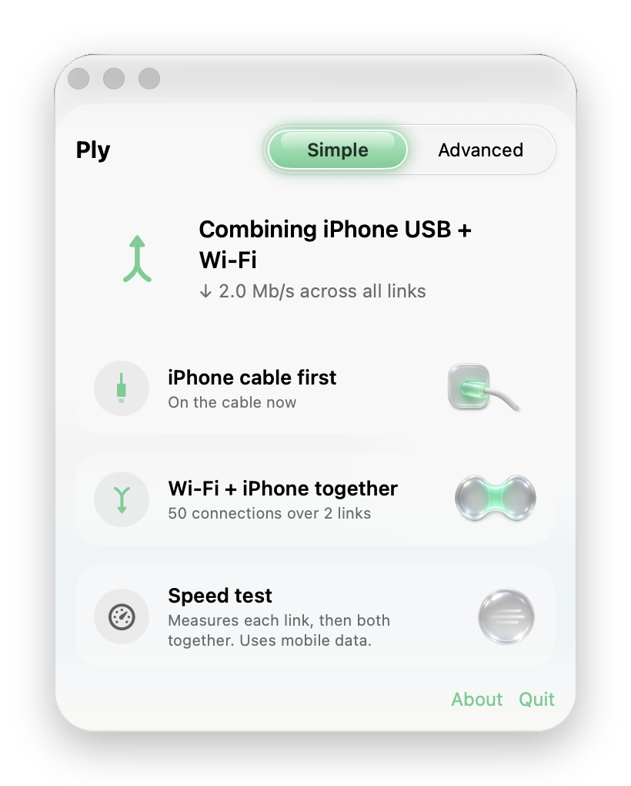
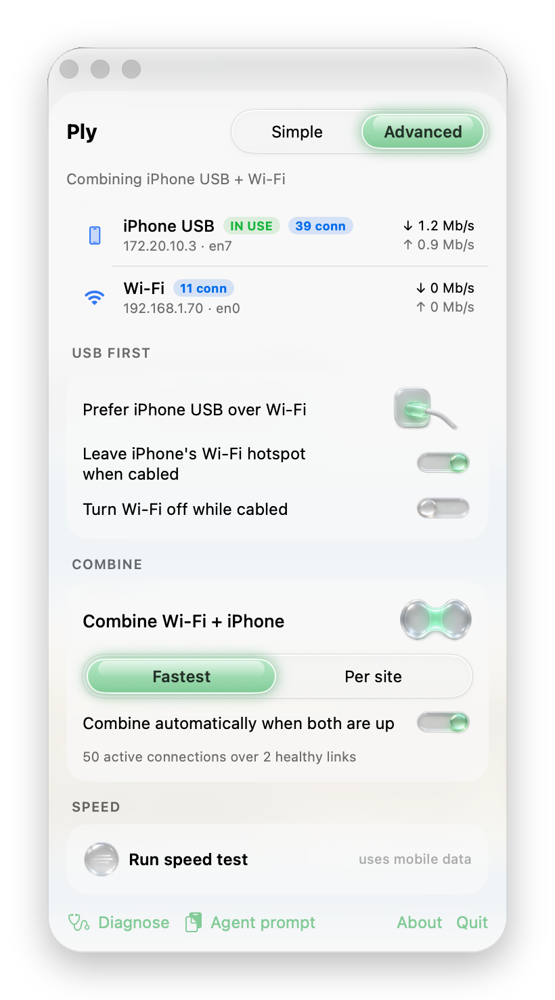

# Ply

**Your iPhone's hotspot over USB, plus Wi-Fi and the iPhone at the same time, on your Mac.**

Ply is a free, open-source menu bar app for macOS. It does two things the Mac doesn't do on its own:

1. **USB first.** When your iPhone is plugged in with Personal Hotspot on, macOS often keeps using Wi-Fi, or joins the iPhone's *Wi-Fi* hotspot instead of using the cable. Ply puts the cable first and keeps it there.
2. **Combine.** Ply spreads your traffic over Wi-Fi *and* the iPhone (and Ethernet) at once, so many connections together get more total bandwidth than one link alone.

There's no VPN, no account and no server. Everything runs on your Mac.

**Built for AI agents first.** Everything you can click in Ply, an agent can do too: every control is an MCP tool, a CLI command and a local HTTP endpoint, all generated from one action list. A test fails the build if the app ever gets a control that agents can't use, or if these docs drift from the code. Agents: start at [For AI agents](#for-ai-agents).

<p align="center">
  
  
</p>
<p align="center"><sub>Simple and Advanced mode, captured from the running app on macOS 26 with an iPhone on the cable.</sub></p>

## For AI agents

Ply is meant to be driven by an agent (Claude Code, Codex, Cursor, any MCP client) as much as by a person. Point your agent at this section, [`docs/llms.txt`](docs/llms.txt) or the skill [`skills/ply/SKILL.md`](skills/ply/SKILL.md).

### Connect

| Interface | How |
| --- | --- |
| **MCP** (stdio) | `claude mcp add ply -- /Applications/Ply.app/Contents/Helpers/ply mcp`. Tools are named `ply_<action>` and return structured JSON. |
| **CLI** | `ply <command> --json`. Install with `brew install mustafaTokmak/tap/ply`, which puts `ply` on PATH. Without Homebrew, `ply` is linked into `/usr/local/bin` when the helper is installed; before that use `/Applications/Ply.app/Contents/Helpers/ply`. `ply actions --json` lists every action with its input schema; `ply action <id> '{"param": ...}'` runs any of them. |
| **HTTP** | `POST http://127.0.0.1:7590/v1/actions/<action>` with a JSON body and `Authorization: Bearer $(cat ~/Library/Application\ Support/Ply/api-token)`. The API listens on 127.0.0.1 only. |
| **OpenAPI** | [`docs/openapi.json`](docs/openapi.json), also served at `GET http://127.0.0.1:7590/openapi.json`. |
| **Docs** | [`docs/llms.txt`](docs/llms.txt), [`docs/llms-full.txt`](docs/llms-full.txt) (every action, parameter, setting, status field and error), [`skills/ply/SKILL.md`](skills/ply/SKILL.md). Also served at `/llms.txt`, `/llms-full.txt` and `/SKILL.md`. |

Any MCP client config:

```json
{ "mcpServers": { "ply": { "command": "/Applications/Ply.app/Contents/Helpers/ply", "args": ["mcp"] } } }
```

To install the skill in Claude Code: `mkdir -p ~/.claude/skills && cp -R skills/ply ~/.claude/skills/`.

### What an agent can do

Everything. The menu, the window, the CLI, the HTTP API and the MCP server all run the same actions through one function, so there is nothing a person can do in the app that an agent can't. That includes reading state (`status`, `diagnose`), changing the network (`prefer_usb`, `set_wifi_power`, `combine_start`), changing every setting (`update_settings`), installing the helper, opening Ply's window to show the person something (`show_window`), and quitting.

<!-- agent-reference:start (generated by `ply docs write .`, do not edit) -->

| Action | What it does | CLI | MCP tool | HTTP |
| --- | --- | --- | --- | --- |
| Status | Which connection the Mac is using right now, every link with its live speed, the macOS service order, Combine state, helper state and findings. | `ply status [--json\|--md]` | `ply_status` | `POST /v1/actions/status` |
| Diagnose | Explain why iPhone USB or Combine is not working and how to fix it. Each finding names the action that fixes it and includes a ready-to-paste agent prompt. | `ply diagnose [--json]` | `ply_diagnose` | `POST /v1/actions/diagnose` |
| Copy agent prompt | A self-contained prompt that describes this Mac's connection state and how to drive Ply, for pasting into any AI agent. | `ply agent-prompt` | `ply_agent_prompt` | `POST /v1/actions/agent_prompt` |
| Put iPhone USB first | Move every iPhone USB network service above Wi-Fi in macOS's service order and turn off macOS's "Disable unless needed" switch for it, so the cable is used whenever it is connected. Needs the helper. | `ply prefer-usb` | `ply_prefer_usb` | `POST /v1/actions/prefer_usb` |
| Combine Wi-Fi + iPhone | Start Combine: a local proxy on 127.0.0.1:7591 spreads new connections across every link with internet (Wi-Fi, iPhone USB, Ethernet) and, with systemProxy, points macOS's auto-proxy at it. A single download stays on one link; many connections add up. | `ply combine on [--split connection\|site] [--no-system-proxy]` | `ply_combine_start` | `POST /v1/actions/combine_start` |
| Stop combining | Stop Combine and restore the proxy settings Ply changed. | `ply combine off` | `ply_combine_stop` | `POST /v1/actions/combine_stop` |
| Speed test | Measure download speed on each link alone and on all links at once. Uses mobile data on the iPhone link (capped by speedTestMaxMB per link per phase). | `ply speedtest [--seconds 5] [--mode both]` | `ply_speed_test` | `POST /v1/actions/speed_test` |
| Wi-Fi power | Turn the Mac's Wi-Fi radio on or off. | `ply wifi on\|off` | `ply_set_wifi_power` | `POST /v1/actions/set_wifi_power` |
| Leave Wi-Fi network | Disconnect Wi-Fi from its current network (for example the iPhone's own Wi-Fi hotspot) without turning Wi-Fi off. | `ply wifi disconnect` | `ply_disconnect_wifi` | `POST /v1/actions/disconnect_wifi` |
| Settings | Read Ply's settings. | `ply settings` | `ply_get_settings` | `POST /v1/actions/get_settings` |
| Change settings | Change one or more settings. Pass only the keys to change. | `ply settings set key=value [key=value ...]` | `ply_update_settings` | `POST /v1/actions/update_settings` |
| Repair iPhone USB | Turn each iPhone USB network service off and on again to wake a tether that is plugged in but not getting an address. Needs the helper. | `ply repair` | `ply_repair_tether` | `POST /v1/actions/repair_tether` |
| Restore proxy settings | Put back every macOS proxy setting Ply changed. Safe to run any time. | `ply restore-proxies` | `ply_restore_proxies` | `POST /v1/actions/restore_proxies` |
| Install helper | Install Ply's small root helper and the `ply` command (asks for an admin password once). The helper can only reorder network services, point proxies at Ply's local PAC file, restore them, and toggle one service. | `ply helper install (or: sudo ply helper install)` | `ply_install_helper` | `POST /v1/actions/install_helper` |
| Uninstall helper | Restore proxies, then remove the helper, its LaunchDaemon and the /usr/local/bin/ply link. | `ply helper uninstall` | `ply_uninstall_helper` | `POST /v1/actions/uninstall_helper` |
| Open at login | Start the Ply menu bar app when you log in. | `ply login-item on\|off` | `ply_set_launch_at_login` | `POST /v1/actions/set_launch_at_login` |
| Open Ply window | Open Ply's window on the user's screen, with the same controls as the menu bar menu. Use it to show the user what Ply is doing, or when the menu bar icon is hidden because the menu bar is full (common on MacBooks with a notch). Opens Ply.app first if it is not running. | `ply open` | `ply_show_window` | `POST /v1/actions/show_window` |
| About Ply | Version, license, source code and documentation links. | `ply about` | `ply_about` | `POST /v1/actions/about` |
| Quit Ply | Stop the running Ply engine (app or daemon), restoring any proxy settings first. | `ply quit` | `ply_quit` | `POST /v1/actions/quit` |

<!-- agent-reference:end -->

### How to work with Ply

1. Start with `ply diagnose --json`. Each finding has a `severity`, a `fix` (the action that resolves it) and an `agentPrompt`.
2. Run the fixes in order, then `ply status --json`. The Mac is on the cable when `primary` is the link whose `kind` is `tether`.
3. Errors are JSON: `{"ok": false, "error": "...", "code": "bad_request|needs_helper|unavailable|failed", "fix": "<action>"}`. If there is a `fix`, run that action and retry.
4. Ask the person first before `install_helper` and `uninstall_helper` (admin password), `set_wifi_power` (they lose Wi-Fi) and `speed_test` (uses mobile data).
5. Never change macOS proxy or network settings directly. Use Ply, so it can restore them.

### Prompt to paste into your agent

> My Mac has the open-source app Ply installed (https://github.com/mustafaTokmak/ply). Use its MCP server (`/Applications/Ply.app/Contents/Helpers/ply mcp`) or its CLI (`ply ... --json`). First run `ply diagnose --json` and fix each finding in order using the action it names. Ask me before installing the helper, turning Wi-Fi off or running a speed test (it uses mobile data). Then run `ply status --json` and tell me which link my Mac is using.

## Why

- You plug your iPhone into the Mac for a faster, steadier connection and to charge it, but macOS keeps using the café Wi-Fi. There are two reasons: **"iPhone USB" sits below Wi-Fi in macOS's service order**, and macOS only uses the first connected service; and iPhone USB has a **"Disable unless needed"** switch, on by default, that keeps the cable idle while any other network works.
- The Mac joins the iPhone's **Wi-Fi** hotspot even though the cable is plugged in. That blocks Wi-Fi from a real network and is slower than the cable.
- You have slow Wi-Fi **and** a fast phone, and you'd like to use both.

## What Ply does

| | |
| --- | --- |
| **Prefer iPhone USB over Wi-Fi** | Moves every iPhone USB service above Wi-Fi in the service order (Ethernet keeps priority), and turns off macOS's **Disable unless needed** switch for it, which is on by default for iPhone USB and keeps the cable idle while Wi-Fi works. It runs once and again whenever macOS re-adds the service. |
| **Leave iPhone's Wi-Fi hotspot when cabled** | If Wi-Fi joins an iPhone hotspot (router `172.20.10.1`) while the cable gives internet, Ply leaves it so Wi-Fi is free for a real network. |
| **Turn Wi-Fi off while cabled** | Optional. Ply turns Wi-Fi back on when you unplug. |
| **Combine Wi-Fi + iPhone** | A local proxy (`127.0.0.1:7591`) sends each new connection over the least-loaded link that has internet. Ply points macOS's auto-proxy (PAC) at it, so browsers and most apps use it with no setup. |
| **Speed test** | Measures each link alone and all links together, bound to each interface. |
| **Simple and Advanced** | Simple shows the two main switches and a speed test. Advanced shows each link with live speeds and every setting. |
| **Diagnose** | Explains what's wrong ("iPhone is plugged in but not sharing", "Wi-Fi is above iPhone USB", ...), with a one-click fix and a ready-to-paste prompt for an AI agent. |

### How Combine works, and what it can't do

```
 Safari / Chrome / apps
          │  (macOS auto-proxy → 127.0.0.1:7591)
          ▼
   Ply local proxy ──► picks a link per connection (weighted by measured speed)
       │        │
     Wi-Fi   iPhone USB  (each connection is bound to one interface)
       │        │
     internet  internet
```

- **One connection uses one link.** A web page loads dozens of connections, and a download manager or `aria2c -x8` opens several, so those spread out and add up. A single TCP download stays on one link. True single-stream bonding needs a server on the other side (like Speedify's paid VPN). Ply deliberately doesn't do that.
- **Your public IP can change between connections**, the same way iCloud Private Relay changes it. Most sites don't care. If a site logs you out, switch Combine to **Per site**, which keeps each site on one link for 10 minutes.
- Combine reaches apps through macOS's proxy settings. UDP traffic (QUIC, video calls, games) and apps that ignore system proxies use the primary link, which is the iPhone cable when USB first is on.
- If Wi-Fi is connected to the *same* iPhone's hotspot, combining adds nothing.
- Combine and speed tests use mobile data on the iPhone link.

## Install

**Homebrew** (installs the app and the `ply` command):

```sh
brew install mustafaTokmak/tap/ply
```

**Or download it:**

1. Download `Ply-<version>.zip` from [Releases](https://github.com/mustafaTokmak/ply/releases), unzip it, and move **Ply.app** to Applications.
2. Open Ply. It lives in the menu bar (an iPhone with a link). If your menu bar is full and the icon is hidden behind the notch, Ply opens its window instead; open Ply again (or run `ply open`) to bring the window back.
3. Click **Install helper** once and enter your admin password. macOS requires admin rights to change the network service order and proxy settings. See [Security](#security) for what the helper can and can't do.

On iPhone: **Settings → Personal Hotspot → Allow Others to Join**. Then plug in the cable and tap **Trust** if asked.

Requires macOS 13 or later, on Apple Silicon or Intel.

### Build from source

```sh
git clone https://github.com/mustafaTokmak/ply && cd ply
swift test                 # needs Xcode
./scripts/build-app.sh     # → dist/Ply.app and dist/Ply-<version>.zip
```

## Use it from the terminal

```sh
ply status            # which link the Mac is using, live speeds, problems
ply diagnose          # what's wrong and the command that fixes it
ply prefer-usb        # put iPhone USB above Wi-Fi
ply combine on        # combine all links (ply combine off to stop)
ply speedtest         # each link alone vs all together
ply open              # show the Ply window (if the menu bar icon is hidden)
ply settings set wifiOffWhenUSB=true combineAuto=true
```

Add `--json` to any command for machine-readable output. If the menu bar app isn't running, `ply daemon` runs the same engine headless. Installing the helper also links `ply` into `/usr/local/bin`.

## Security

- **The helper** (`/Library/PrivilegedHelperTools/app.ply.helper`, a LaunchDaemon) is the only part that runs as root. It understands six requests and nothing else:
  1. report its version;
  2. reorder existing network services;
  3. point services' auto-proxy at `http://127.0.0.1:<port>/proxy.pac`. It refuses any other URL and backs up the old settings first;
  4. restore those proxy settings;
  5. turn one existing network service off and on;
  6. turn off **Disable unless needed** for existing services (it can't turn it on).

  It never runs shell commands, and only root or the logged-in console user can talk to it. The code is in [`Sources/PlyHelper/main.swift`](Sources/PlyHelper/main.swift).
- **The local API** listens only on 127.0.0.1. It needs a per-user token (mode 600) and rejects requests whose Host header isn't 127.0.0.1 or localhost, which blocks DNS-rebinding attacks from web pages.
- **Fail-safe proxy:** the PAC file ends in `DIRECT`, so if Ply quits or crashes, browsers fall back to a normal connection. Ply also restores proxy settings when it quits and again the next time it starts.
- **No telemetry.** The only network requests Ply makes on its own are link health checks to `captive.apple.com`, which is the same URL macOS uses. Speed tests download from `speed.cloudflare.com` only when you run them.

## Uninstall

Run **Quit** in the menu, then `ply helper uninstall`, which restores proxies and removes the helper and the `ply` link. Then delete Ply.app. Your service order and the iPhone USB **Disable unless needed** switch stay as they are.

## FAQ

**Android?** Phones that show up as a USB Ethernet device work. Add the interface name with `ply settings set 'tetherInterfaces=["en9"]'`.
**iPad?** Yes. "iPad USB" is detected the same way as iPhone USB.
**Does it need a server or subscription?** No.
**Does it change my settings for good?** Only the service order and iPhone USB's **Disable unless needed** switch, which are the point of USB first. You can turn the switch back on in System Settings > Network > iPhone USB > Details. Proxy changes are temporary and restored.

## License

MIT. See [LICENSE](LICENSE).
